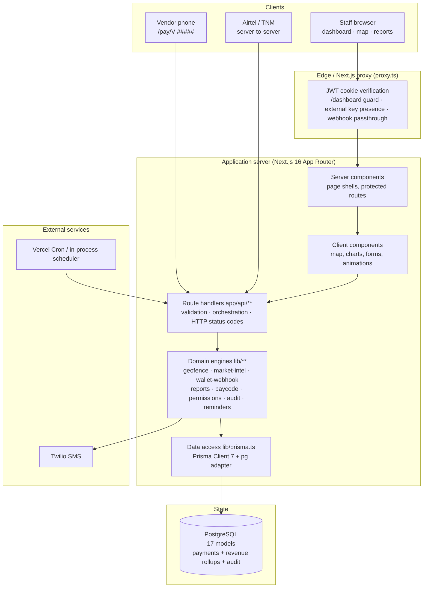
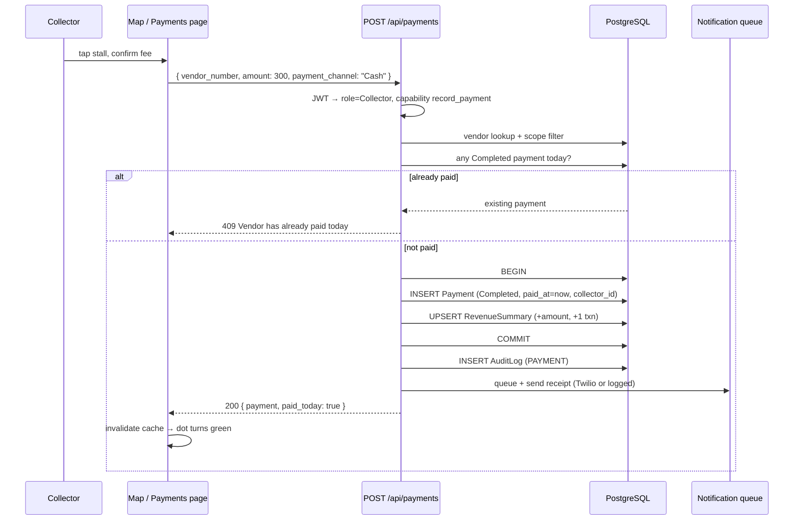
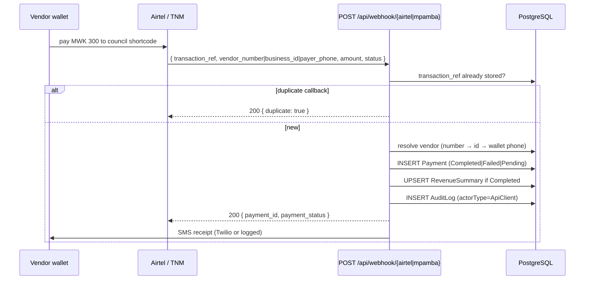
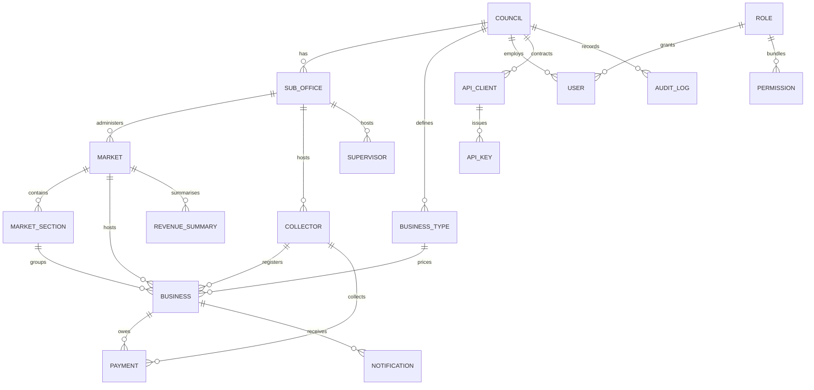

# Msika — Digital Market Fee Management & Revenue Monitoring System

**Blantyre City Council · Limbe Market (case study)**
A web platform that replaces paper market-fee tickets with a geo-referenced, auditable,
real-time revenue system for city councils.

[](https://nextjs.org)
[](https://react.dev)
[](https://www.typescriptlang.org)
[](https://www.prisma.io)
[](https://tailwindcss.com)
[](#10-validation--testing)

> **Where things live**
> The full application is in [`msika-app/`](msika-app/).
> Deep-dive endpoint walkthroughs: [`msika-app/docs/api-test-suite.md`](msika-app/docs/api-test-suite.md)
> and [`msika-app/docs/QUICK-CURL-TESTS.md`](msika-app/docs/QUICK-CURL-TESTS.md).
> Application-level notes: [`msika-app/README.md`](msika-app/README.md).

---

## Contents

1. [Problem, aim and scope](#1-problem-aim-and-scope)
2. [System at a glance](#2-system-at-a-glance)
3. [Architecture](#3-architecture)
4. [Technology stack](#4-technology-stack)
5. [Data model](#5-data-model)
6. [Roles, permissions and data scoping](#6-roles-permissions-and-data-scoping)
7. [API reference](#7-api-reference)
8. [Algorithms (the core of the system)](#8-algorithms-the-core-of-the-system)
9. [Security design](#9-security-design)
10. [Validation & testing](#10-validation--testing)
11. [Performance and scalability](#11-performance-and-scalability)
12. [Deployment and operations](#12-deployment-and-operations)
13. [Repository structure](#13-repository-structure)
14. [Limitations and future work](#14-limitations-and-future-work)
15. [Defence / viva preparation](#15-defence--viva-preparation)
16. [Glossary](#16-glossary)

---

## 1. Problem, aim and scope

### 1.1 Context

Blantyre City Council collects a **daily market fee** from every licensed vendor at
Limbe Market. The official fee schedule is fixed by vendor category
(Market Vendor MWK 300, Kupikulisa bulk trader MWK 2,000, Restaurant / Butchery MWK 500).
The legacy process is a paper ticket book: a collector walks the stalls, writes a
ticket, and hands over cash at the end of the day.

That process has four measurable weaknesses:

| Weakness | Consequence |
|---|---|
| No single source of truth | Cash handed in cannot be reconciled against a register of who actually paid |
| Tickets are anonymous | A used ticket can be re-shown, or a vendor can be marked paid without paying |
| No live visibility | Management learns daily totals hours later, not while collection is happening |
| No vendor history | Repeat defaulters cannot be identified, so enforcement is arbitrary |

### 1.2 Problem statement

> Design and implement a digital market-fee management and revenue-monitoring system that
> records every payment against a known vendor and stall, proves where and when the money
> was collected, prevents duplicate daily charging, gives supervisors live revenue figures,
> and produces an audit trail suitable for public-sector accountability.

### 1.3 Objectives

1. **Digitise collection** — cash and mobile-money payments recorded against a vendor record, not a paper stub.
2. **Geo-reference every vendor** — a map of the market where each stall sits at its recorded GPS position and changes colour the moment its fee is settled.
3. **Prevent double charging** — one vendor pays one daily fee; the server rejects a second payment for the same calendar day.
4. **Accept mobile money** — Airtel Money and TNM Mpamba, with provider callbacks updating payment state and issuing SMS receipts.
5. **Monitor revenue live** — dashboard KPIs, daily/monthly/compliance/collector/revenue reports and CSV export.
6. **Make every action attributable** — role-scoped access, audit log of logins, registrations, payments and key management.
7. **Reduce defaults proactively** — an automatic SMS reminder engine with a per-vendor cooldown, plus a vendor reliability score that ranks enforcement priorities.

### 1.4 Scope and boundaries

**In scope:** staff authentication and role-based access; vendor enrolment; cash collection;
mobile-money initiation and provider callbacks; live geo-referenced map; dashboards and
reports; SMS notifications/reminders; external provider API with keys and rate limiting;
audit logging.

**Out of scope (deliberately, for this project):** real wallet settlement (sandbox
integration, not a licensed payment aggregator); offline-first operation; multi-council
self-service onboarding; general-ledger double-entry accounting; native mobile apps.

### 1.5 Actors

| Actor | Authentication | What they can do |
|---|---|---|
| **Administrator** | username + password → JWT cookie | Oversight: staff, API clients, audit trail, reports, map. **Cannot collect cash or enrol vendors** (separation of duties) |
| **Supervisor** | username + password | Everything inside their sub-office: enrol vendors, record payments, reports, map |
| **Collector** | username + password | Enrol vendors, record **cash** payments (attributed to them), map |
| **Vendor** | none — QR pay-code or staff assistance | View/pay their own daily fee |
| **Wallet provider** (Airtel / TNM) | `x-api-key` (external API) or public webhook | Push payment confirmations |
| **Scheduler** | `Authorization: Bearer $CRON_SECRET` | Trigger the reminder run |

---

## 2. System at a glance

| Property | Value |
|---|---|
| Application type | Server-rendered full-stack web app (Next.js App Router) + REST API |
| Pages | 27 routes (login, 24 dashboard screens, public QR pay page, landing) |
| API surface | 31 route modules under `app/api/**` (39 HTTP handlers) |
| Database | PostgreSQL, 17 Prisma models |
| Primary keys | Auto-increment integers; vendor business key `vendor_number` (`V-#####`) |
| Auth | bcrypt password hashes + HS256 JWT in an `httpOnly` cookie (8 h) |
| Payment channels | `Cash`, `AirtelMoney`, `TNMMpamba`, `USSD`, `Bank` |
| Payment states | `Pending`, `Completed`, `Failed`, `Reversed`, `Refunded` |
| Money type | `Decimal(10,2)` in MWK (whole kwacha in practice) |
| Test suite | `scripts/smoke.sh` — 66 assertions, 1 expected warning, 0 failures |
| Deployment target | Vercel (or any Node host) + managed PostgreSQL |

---

## 3. Architecture

### 3.1 Logical architecture



**Layering rule.** HTTP concerns (cookies, status codes, JSON shapes) live in
`app/api/**/route.ts`. Reusable domain logic lives in `lib/**` and is imported by routes,
pages and each other. Prisma is only instantiated once (`lib/prisma.ts`, cached on
`globalThis` in development to avoid connection storms during hot reload).

### 3.2 Request pipeline

Every API call passes through the same six stages:

| Stage | Implementation | Failure mode |
|---|---|---|
| 1. Edge guard | `proxy.ts` verifies the JWT on `/dashboard/*` (redirect if absent), requires `x-api-key` to be present on `/api/external/*`, and passes webhooks through | redirect to `/login` / 401 |
| 2. Session resolution | `getSessionUser()` → `lib/session.ts` | 401 |
| 3. Capability check | `can(role, capability)` → `lib/capabilities.ts` | 403 with a human-readable reason |
| 4. Scope resolution | `getScope(user)` → collector/supervisor ids + sub-office | empty scope → empty results |
| 5. Query filter | `businessScopeFilter` / `paymentScopeFilter` merged into Prisma `where` | a user cannot widen their own scope |
| 6. Transaction + side effects | `prisma.$transaction`, `logAudit`, `notifyVendor` | 409 (duplicate), 400 (validation), 500 (safe message) |

### 3.3 Sequence: cash payment (collector)



### 3.4 Sequence: mobile money callback



Wallet payments are inserted as `Pending` when a collector initiates them from the
Payments screen; the provider callback later promotes them to `Completed` or `Failed`.
The map only colours a stall green for `Completed` payments.

### 3.5 Key architectural decisions and trade-offs

| Decision | Alternative considered | Why this choice |
|---|---|---|
| **Full-stack Next.js monolith** (UI + API + server rendering in one deployable) | Separate Express/Django API + SPA | One language, one deployment, no CORS surface, server-rendered pages are fast on 2G-class connections; council-scale traffic does not justify distributed complexity |
| **PostgreSQL + Prisma** | MongoDB / raw SQL | Fee, payment, vendor and tenancy data are strictly relational; Prisma gives typed queries and migration history; PostgreSQL adds transactions and decimal arithmetic for money |
| **JWT in `httpOnly` cookie** | Server-side session table / localStorage | Stateless horizontal scaling, immune to XSS token theft (`httpOnly`), `sameSite=lax` blocks cross-site CSRF for state-changing POSTs |
| **Role capability matrix in code** (`lib/capabilities.ts`) | Database permission table only | Permissions must be checkable on both server and client from the same source; the DB `Role`/`Permission` tables still exist for extensibility |
| **Separation of duties** (admin cannot collect) | Admin super-user | In public finance, the person who can change the rules should not be the person who handles cash; every collection is attributable to a field officer |
| **Revenue rollup table** (`RevenueSummary`) | Recompute totals on every dashboard load | Bounded-row pre-aggregation keeps dashboards O(days) instead of O(payments); it is upserted inside the same transaction as the payment |
| **Provider webhooks + external API** | Screen-scraping or manual entry | The only reliable way to confirm a wallet payment; idempotent on `transaction_ref` so retries are safe |
| **Public QR pay page per vendor** | Vendors log in to an app | Zero training for vendors; the stall QR opens `/pay/V-#####`, and the payment request must carry the server-derived code issued to that page |

**Why not microservices?** At Limbe's scale (≈1–10k vendors, ≤2 writes per vendor per day)
a modular monolith gives transactional integrity with far less operational risk. The
domain modules are already separated by responsibility, so a future extraction of, say,
the analytics engine into a queue worker would be a deployment change, not a rewrite.

---

## 4. Technology stack

### 4.1 Runtime and application

| Layer | Technology | Version | Role in Msika |
|---|---|---|---|
| Framework | **Next.js** (App Router) | 16.2.11 | Routing, server components, route handlers, `proxy.ts` edge guard |
| UI runtime | **React** | 19.2.4 | Client interactivity (map, charts, forms, animation) |
| Language | **TypeScript** | 5.x (strict) | End-to-end typing of API payloads and domain models |
| Styling | **Tailwind CSS** | v4 (PostCSS plugin) | Utility-first design system, responsive layouts |
| Icons | **lucide-react** | 1.26 | Icon set for navigation and cards |
| Class utilities | `clsx`, `tailwind-merge` | 2.1 / 3.6 | Conditional class composition without duplicate utilities |

### 4.2 Data

| Layer | Technology | Version | Role |
|---|---|---|---|
| Database | **PostgreSQL** | 14+ | System of record: vendors, payments, rollups, audit |
| ORM | **Prisma** | 7.9 | Typed queries, schema-as-code, migrations |
| Driver adapter | `@prisma/adapter-pg` | 7.9 | Node `pg` connection pooling |
| Seed | `tsx` + `prisma/seed.ts` | 4.23 | Deterministic demo dataset (48 vendors, 6 sections, staff, payments) |

### 4.3 Security and integrations

| Technology | Version | Role |
|---|---|---|
| **jose** | 6.2 | HS256 JWT signing/verification (8 h expiry) |
| **bcryptjs** | 3.0 | Password hashing (cost 10) for staff accounts |
| **qrcode** | 1.5 | Generates each stall's payment QR code |
| **Twilio** | 6.1 | SMS receipts and payment reminders (log fallback without keys) |
| **Leaflet / react-leaflet** | 1.9 / 5.0 | Map rendering with OpenStreetMap tiles, market polygon |
| **Recharts** | 3.10 | Dashboard and report charts |
| Node `crypto` | built-in | API keys (`randomBytes`), SHA-256 hashing, pay-code derivation |

### 4.4 Tooling

| Tool | Version | Role |
|---|---|---|
| ESLint + `eslint-config-next` | 9 | Static analysis |
| `scripts/smoke.sh` | — | 66-check end-to-end black-box suite |
| Vercel | — | Hosting, CDN, cron trigger |
| `vercel.json` | — | Daily reminder cron at 08:00 UTC |

---

## 5. Data model

### 5.1 Entity-relationship overview (17 models)



### 5.2 Table groups

| Group | Models | Notes |
|---|---|---|
| Tenancy | `Council`, `SubOffice`, `Market`, `MarketSection` | Council → sub-office → market → section hierarchy; every business row carries `council_id` |
| Identity | `Role`, `Permission`, `User`, `Collector`, `Supervisor` | Staff passwords are bcrypt hashes; usernames are unique; `is_active` provides soft disable |
| Commerce | `BusinessType`, `Business` | Fee schedule per type; vendor keeps exact GPS coordinates and wallet details |
| Money | `Payment`, `RevenueSummary` | Payment is the ledger of record; `RevenueSummary` is a per-market/day aggregate with `@@unique(market_id, summary_date)` |
| Access | `ApiClient`, `ApiKey` | Keys are stored as SHA-256 hashes with permissions, rate limit and expiry |
| Governance | `AuditLog`, `Notification` | Immutable trail of actions; outbound SMS records with delivery status |

### 5.3 Invariants enforced by the system

1. **One completed payment per vendor per calendar day** — checked before insert, returns HTTP 409.
2. **Payment amount must equal the vendor's applicable fee** (`BusinessType.fee_amount`); a mismatched amount is rejected with 400.
3. **Collectors record cash only** — a collector submitting `AirtelMoney`/`TNMMpamba` gets 403; wallet payments are vendor-initiated.
4. **Wallet records are idempotent** on `transaction_ref` (unique column) — a replayed provider callback returns the original payment.
5. **Cash payment + revenue rollup are atomic** — both writes happen inside `prisma.$transaction`; wallet callbacks write the rollup immediately after the payment insert. The dashboard therefore never shows money that is not in the ledger, and `RevenueSummary` can always be rebuilt from `Payment`.
6. **Vendor and payment reads are scope-filtered** in the database query, not in the UI.

---

## 6. Roles, permissions and data scoping

### 6.1 Capability matrix (`lib/capabilities.ts`)

| Capability | Administrator | Supervisor | Collector |
|---|:--:|:--:|:--:|
| `record_payment` | ✗ | ✓ | ✓ |
| `register_vendor` | ✗ | ✓ | ✓ |
| `view_map` | ✓ | ✓ | ✓ |
| `view_reports` | ✓ | ✓ | ✗ (reports are still reachable and scoped to own payments) |
| `view_audit` | ✓ | ✗ | ✗ |
| `manage_users` | ✓ | ✗ | ✗ |
| `manage_api_clients` | ✓ | ✗ | ✗ |

Enforcement happens **twice**: the UI hides what a role cannot do, and the route handler
re-checks with `can()` before touching the database. A forged request therefore fails even
if the UI is bypassed.

The matrix is the single policy source (`lib/capabilities.ts`). `record_payment` and
`register_vendor` are enforced by `can()` at the API boundary; staff, audit and API-client
routes additionally require `role === "Administrator"`. Reports and the live map are
currently available to **every signed-in staff member** and restricted by scope filters
rather than by capability, so a collector sees reports for their own recordings only.

### 6.2 Data scoping (`lib/permissions.ts`)

| Role | Vendors visible | Payments visible |
|---|---|---|
| Administrator | all | all |
| Supervisor | vendors in markets under their sub-office | payments whose vendor's market is in their sub-office |
| Collector | all (needed for collection and search) | payments they recorded **plus** wallet payments on vendors they registered |
| Unknown / no session | none (`{ business_id: -1 }`) | none (`{ payment_id: -1 }`) |

The scope is translated into Prisma filters and merged with `AND`, so a client-supplied
`market_id` or `collector_id` cannot widen the result set.

### 6.3 Why administrators cannot collect cash

The capability split is a **fraud-control** decision, not an arbitrary restriction:
an administrator can adjust fees and staff accounts, so allowing the same account to
record collections would remove the independent record of who handled money. Every
`Payment` row therefore carries `collector_id` (nullable only for vendor-initiated wallet
payments), and the audit entry names the officer.

---

## 7. API reference

All endpoints live under `msika-app/app/api/**`. Cookie-authenticated endpoints expect the
`token` cookie set at login. Errors follow standard HTTP semantics with a JSON
`{ "error": "message" }` body.

### 7.1 Authentication

| Method & path | Auth | Purpose |
|---|---|---|
| `POST /api/auth/login` | — | Verify username/password against collectors, supervisors or admin users; sign JWT; set `token` cookie (`httpOnly`, `sameSite=lax`, `secure` in production, 8 h) |
| `POST /api/auth/logout` | cookie | Clear the session cookie |
| `GET /api/auth/me` | cookie | Current user profile and role |
| `POST /api/auth/change-password` | cookie | Self-service password change (bcrypt cost 10) |
| `POST /api/staff/reset-password` | admin | Reset a staff member's password |

### 7.2 Vendors

| Method & path | Auth | Purpose |
|---|---|---|
| `GET /api/vendors?search=&market_id=` | cookie | List vendors with today's paid status (max 500) |
| `POST /api/vendors` | collector / supervisor | Register vendor; allocates `vendor_number`, stores exact GPS, returns geofence check |
| `GET /api/vendors/{vendor_number\|business_id}` | cookie | Vendor profile + recent payments (scoped) |
| `GET /api/vendors/meta` | cookie | Business types, fees, markets and sections for the registration form |
| `GET /api/public/pay-status?vendor_number=` | public | Minimal stall info + today's fee for the QR page |

### 7.3 Payments

| Method & path | Auth | Purpose |
|---|---|---|
| `GET /api/payments?status=&search=&limit=` | cookie | Transaction list with vendor + collector (scoped) |
| `POST /api/payments` | collector / supervisor | Cash → `Completed` immediately; wallet initiation → `Pending`. 403 for admin, 409 for duplicate day |
| `GET /api/payments/verify?vendor_number=` | cookie | Field verification: vendor, today's fee, paid/unpaid, last payments |
| `POST /api/pay/paycode` | pay-code | Public QR payment; verifies HMAC-derived pay-code, idempotent per day |
| `POST /api/webhook/airtel` | public | Airtel Money callback (status mapping `TS`/`SUCCESS` → Completed, `TF`/`FAILED` → Failed) |
| `POST /api/webhook/mpamba` | public | TNM Mpamba callback, same processor |

### 7.4 Analytics and reporting

| Method & path | Auth | Purpose |
|---|---|---|
| `GET /api/dashboard` | cookie | KPIs, revenue trend, channel mix, section split, new-vendor growth |
| `GET /api/map?filter=paid\|unpaid` | cookie | Vendor coordinates + payment status for the live map |
| `GET /api/reports/daily?date=YYYY-MM-DD` | cookie | Day report: totals, breakdown by channel, fee type and section |
| `GET /api/reports/summary?type=monthly\|compliance\|collectors\|revenue` | cookie | Live report tables (JSON) |
| `GET /api/reports/export?type=…` | cookie | Same report as CSV download (print view saves PDF) |
| `GET /api/market-intel` | cookie | MRI scoring, section analytics, watchlist, streaks |
| `GET /api/pulse` | cookie | Market pulse summary |
| `GET /api/reminders` / `POST /api/reminders` | cookie | List today's unpaid vendors / send reminders now |
| `GET\|POST /api/cron/reminders` | bearer `CRON_SECRET` | Scheduled reminder run (503 if unset in production, 401 if wrong bearer) |

### 7.5 Administration

| Method & path | Auth | Purpose |
|---|---|---|
| `GET /api/audit-logs` | admin | Filterable audit trail |
| `GET\|POST\|PATCH /api/api-clients` | admin | Manage provider clients and mint API keys (plaintext shown once) |
| `GET\|POST /api/collectors` | admin | List/create collectors |
| `GET\|POST\|DELETE /api/supervisors` | admin | List/create/deactivate supervisors |
| `GET\|POST /api/markets` | staff / admin | List markets; create market and sections |

### 7.6 External provider API

Authenticated with `x-api-key`, verified by SHA-256 hash lookup against `ApiKey`
(active + unexpired). Rate limit is a fixed one-minute window per client
(seeded clients: 1,000 requests/minute).

| Method & path | Purpose |
|---|---|
| `GET /api/external/vendors?vendor_number=` | Look up a vendor for reconciliation |
| `GET /api/external/payments?vendor_number=&limit=` | Payment history |
| `POST /api/external/payments` | Push a real payment (same processor as the webhooks) |

**Status codes used:** 200/201 success, 400 validation, 401 unauthenticated or bad key,
403 capability denied / invalid pay-code, 404 unknown vendor, 409 duplicate payment,
429 rate limit, 500 safe server error.

---

## 8. Algorithms (the core of the system)

### 8.1 Geo-referencing and geofencing (`lib/geofence.ts`)

Every vendor has a position on the map. The system uses four techniques:

**(a) Ray-casting point-in-polygon.** The Limbe Market boundary is an ordered list of
8 `{lat, lng}` vertices traced from OpenStreetMap. For a point *P*, cast a horizontal ray to
the right and count edge crossings:

```
inside = false
for each edge (i, j = i-1):
    if (yi > P.lat) != (yj > P.lat):
        xIntersect = (xj - xi) * (P.lat - yi) / (yj - yi) + xi
        if P.lng < xIntersect: inside = !inside
```

Odd number of crossings ⇒ inside. Cost is **O(n)** for n vertices (n = 8 here), no
trigonometry, and it is exact for simple polygons.

**(b) Haversine distance.** Great-circle distance to the market centroid
(−15.8171, 35.0539):

```
a = sin²(Δφ/2) + cos φ1 · cos φ2 · sin²(Δλ/2)
d = 2R · asin(√a),  R = 6 371 000 m
```

Used for the "distance from market centre" figure returned at registration and for ranking
the nearest boundary point.

**(c) Boundary projection.** Derived positions (the seed dataset and the no-GPS fallback) can
fall outside the fence; projecting them onto every polygon **segment** keeps the map dot
where a stall could physically exist. The clamped parametric projection is

```
t = ((P − A)·(B − A)) / |B − A|²,  clamped to [0,1]
C = A + t(B − A)
```

and the closest resulting point is chosen — a nearest-point-on-polygon computation in O(n).
Note that this is **only** applied to derived positions: coordinates captured by a collector
at registration are stored exactly as recorded (see below).

**(d) Deterministic stall placement.** When no GPS is captured, the vendor still needs a
stable, unique dot. A 31-base rolling hash of the vendor number produces a ±55 m offset
from the section anchor:

```
hash = (hash·31 + charCode) | 0
dLat = ((hash mod 100) − 50) / 100000
dLng = (((hash >> 7) mod 100) − 50) / 100000
```

The same vendor always maps to the same position; no random reassignment on refresh.

> **Design decision:** registration stores the **exact** recorded coordinates and reports
> `inside`/`outside` + distance for information. Snapping is only used for the derived
> fallback, never to silently move an officer's recorded evidence.

### 8.2 Vendor number allocation

`V-#####` is generated from a 5-digit random space (`10000–99999`), checked for
uniqueness, retried up to 5 times, then falls back to a timestamp-based value. This keeps
IDs human-readable on printed citations while remaining non-sequential (so a stall number
does not disclose how many vendors the council has).

### 8.3 Daily idempotency (the "one fee per day" rule)

```
today = truncateToMidnight(now)
already = SELECT 1 FROM Payment
          WHERE business_id = ? AND status = 'Completed' AND paid_at >= today
if already: return 409
```

The rule is enforced in the cash route and the pay-code route, so mixing cash with a QR
payment cannot charge the vendor twice. Provider callbacks are de-duplicated by
`transaction_ref` (a `@unique` column) — that makes retries idempotent, and a callback for a
day that is already settled is left to the council's reconciliation report rather than being
rejected, because the funds have already moved at the provider.

### 8.4 Msika Reliability Index (MRI) — vendor payment scoring

`lib/market-intel.ts` scores every active vendor 0–100 for *how reliably the stall pays its
daily fee*. It is the analytical centrepiece of the system.

**Window:** the last 30 days, clamped to the vendor's age (a 4-day-old stall is not
punished for 26 days it did not exist).

**Components:**

1. **EWMA compliance `W`** — exponentially weighted share of days paid, half-life 10 days:

   ```
   W = Σ_{age=0}^{n-1} paid(age) · 0.5^(age/10)
       ────────────────────────────────────────
              Σ_{age=0}^{n-1} 0.5^(age/10)
   ```

   A payment yesterday carries ~2× the weight of one 10 days ago, so the score reacts to
   current behaviour without ignoring history.

2. **Momentum `S`** — consecutive paying days, saturating at 14:

   ```
   S = min(currentStreak / 14, 1)
   ```

   Saturation prevents a single long streak from dominating the whole score.

3. **Consistency `C`** — regularity of inter-payment gaps:

   ```
   gaps = differences between consecutive paid dates (days)
   C = clamp(1 − σ(gaps)/μ(gaps), 0, 1)
   ```

   A vendor who pays every day has σ = 0 ⇒ C = 1. Erratic payers score low even if their
   total count is similar.

**Raw score and empirical-Bayes shrinkage:**

```
MRI_raw = 100 · (0.60·W + 0.25·S + 0.15·C)
MRI     = (n·MRI_raw + k·100·m̄) / (n + k)        n = active days, k = 10
```

`m̄` is the market-wide compliance prior (share of active days paid across all scoped
vendors). Shrinkage is the key statistical idea: **a new vendor with 3 good days should not
outrank a vendor with 300 good days**, and a new vendor should not start at 0 either. With
k = 10, a 4-day-old stall is pulled ~71 % toward the market average; a 30-day stall is
pulled only 25 %.

**Worked example** (30-day window, paid 28 days, current streak 12, one 2-day gap,
market prior 0.72):

| Quantity | Value |
|---|---|
| `W` | 0.94 |
| `S` | 12 / 14 = 0.86 |
| `C` | 0.65 |
| `MRI_raw` | 100 × (0.6·0.94 + 0.25·0.86 + 0.15·0.65) = 87.3 |
| `MRI` | (30·87.3 + 10·72) / 40 = **83 → Reliable** |

**Tiers:** ≥ 85 Excellent · ≥ 70 Reliable · ≥ 50 Watch · ≥ 30 At Risk · < 30 Chronic.

**Revenue at risk** converts the score into money so enforcement can be prioritised:

```
revenue_at_risk = daily_fee × (1 − MRI/100)
```

A MWK 300 stall at MRI 34 costs the council ≈ MWK 198/day; the watchlist is sorted by this
value, so enforcement visits the stalls costing the most, not just the lowest scores.

**Complexity:** one Prisma pass over 30 days of payments plus one scoring pass per vendor —
**O(P + V·W)** with P payments in the window, V vendors, W = 30 days. All constants are
exported from `lib/mri.ts`, and `scoreVendor` is a pure function, so it can be unit-tested
without a database.

### 8.5 Reporting aggregation (`lib/reports.ts`)

Reports are computed with a **single pass** over the scoped payments and Maps keyed by
channel / fee type / section / day:

```
for each payment:
    channelTotals[channel] += amount
    feeTypeTotals[fee_type] += amount
    sectionTotals[section] += amount; sectionCount[section] += 1
    vendors.add(business_id)
```

That is O(P) time and O(distinct keys) memory instead of repeated `GROUP BY` round-trips.
Reports available: **daily** (one day, with channel/fee/section breakdown), **monthly**
(last 6 calendar months), **compliance** (paid vs unpaid by section), **collectors**
(cash handled per officer) and **revenue trend** (weekly series). The same `ReportTable`
object feeds the screen, the print view (PDF) and the CSV serializer
(`toCsv`, RFC-4180-style escaping), so what is exported is exactly what was on screen.

### 8.6 Reminder scheduling (`lib/auto-reminders.ts`, `instrumentation.ts`)

```
if now − lastRun < 5 min: throttle
targets = activeVendors − paidToday − remindedInLast6h
for each target: create Notification, send SMS, update status
pause 250 ms every 5 messages
```

* **Per-vendor cooldown 6 h** — implemented by querying recent `Notification` rows and
  subtracting those vendor ids, so it survives process restarts (unlike an in-memory map).
* **Global throttle 5 min** — prevents double runs when both the scheduler and an external
  cron fire close together.
* **Two triggers:** an in-process interval every 30 minutes on a persistent Node host
  (`instrumentation.ts`), and `GET /api/cron/reminders` for Vercel Cron at 08:00 UTC.
* **Graceful degradation:** with no Twilio credentials, messages are persisted with status
  `Logged`; the workflow still produces evidence and never blocks the payment path.

### 8.7 API keys and rate limiting (`lib/api-auth.ts`, `lib/rate-limit.ts`)

* Key format `msika_<64 hex chars>` from `crypto.randomBytes(32)`.
* Only the **SHA-256 hash** is stored; the plaintext is returned once at creation.
* Validation requires `is_active = true` and `expires_at` null/future; successful use updates
  `last_used_at` for forensics.
* Fixed-window limiter: a `Map<identifier, {count, resetAt}>` with a 60-second window,
  returning HTTP 429 when the client exceeds its limit.
* Permissions are stored as JSON (legacy comma-separated format still parsed), so scopes can
  be extended per client.

### 8.8 Pay-code derivation (`lib/paycode.ts`)

```
code = SHA-256("paycode:" + vendorNumber + ":" + JWT_SECRET)[0..32]
```

The stall QR encodes the public URL `/pay/V-#####`. The pay page calls
`GET /api/public/pay-status`, which returns today's fee, paid state and this code; the page
then submits `POST /api/pay/paycode` with `{ vendor_number, code, amount, payment_channel }`.
Verification recomputes the digest and compares it with an XOR accumulator over all
characters (constant-time-ish, no early exit), so timing cannot reveal a matching prefix.

What this buys: the code is bound to one vendor and derived from a server-only secret, so a
payment cannot be posted for an arbitrary vendor number without going through the issued
flow, and the code is stable — printed labels never expire. It is **not** proof of physical
stall ownership, because the pay-status endpoint issues the code publicly. Stronger
protection (a short-lived signed token bound to a scan session) is listed as future work.

### 8.9 Money handling

Amounts use `Decimal(10,2)` in PostgreSQL and are converted with `Number()` only for
display and arithmetic on already-validated values. Fee validation compares the submitted
amount to `BusinessType.fee_amount`; there is no free-text amount field for collectors.
`RevenueSummary` is upserted in the same transaction as a cash payment and immediately after
a confirmed wallet callback, so the aggregate never drifts from the ledger (it is derived
state, rebuildable from `Payment` at any time).

---

## 9. Security design

### 9.1 Threat model and controls

| Threat | Control in Msika |
|---|---|
| Credential stuffing / password theft | bcrypt cost 10, generic "Invalid username or password", inactive accounts rejected |
| Session hijacking | JWT in `httpOnly` cookie (no JS access), `sameSite=lax`, `secure` in production, 8 h expiry, signature verified on every request |
| Privilege escalation | Capability re-check on the server for every mutating route; scope filters injected into queries |
| Collector falsifying a payment | `collector_id` always taken from the authenticated session, never from the request body; amount forced to the official fee; audit row with IP and user agent |
| Double payment / replay | Per-day duplicate check, unique `transaction_ref`, idempotent webhook processor |
| Forged QR pay-code | Code is derived from a server-only secret and compared in constant time; payment requests must carry the code issued to that vendor's pay page |
| Stolen API key | Only hashes stored, per-key permissions, expiry and `is_active` switch, rate limiting, `last_used_at` trail |
| SQL injection | Parameterised queries through Prisma; no string-built SQL |
| XSS | React escapes output by default; no `dangerouslySetInnerHTML` in the app |
| CSRF | Same-origin API + `sameSite=lax` cookie; state changes are POST-only |
| Secret leakage | All secrets in environment variables; `.env*` and `*.jar` (cookie jars) are git-ignored; no credentials in source |
| Repudiation | `AuditLog` captures actor type/id/name, action, resource, details, IP and user agent; audit writes are fail-safe (never break the money path) |

### 9.2 Known residual risks (and the mitigation plan)

| Risk | Status | Planned mitigation |
|---|---|---|
| Provider webhooks are not signature-verified | Open | Add HMAC verification with per-provider shared secrets and timestamp tolerance before live traffic |
| Two distinct wallet references for one day are not collapsed | Possible overpayment, visible in reports | Per-day reconciliation rule: credit the first, flag the second for refund |
| Pay-code is issued publicly by pay-status | Binds a payment to the app flow, not to stall ownership | Short-lived signed scan token, or issue the code only in the printed QR |
| Rate limiting is in-process memory | Acceptable for single instance | Move to Redis/Postgres when running multiple instances |
| Daily-duplicate check is query-then-insert (small race window) | Low at current concurrency | Add a partial unique index on `(business_id, paid_on)` or a serializable transaction |
| External API queries are not council-scoped | Open | Add council filter derived from the API client's `council_id` |
| No refresh-token rotation | By design (8 h expiry) | Re-authentication on expiry; optional refresh tokens if session length becomes a complaint |
| Vendor number space is random with retry (no sequence lock) | Low | Move to a database sequence with a prefixed formatter if volume grows |

Stating these explicitly is deliberate: an audit-friendly system documents where assurance
ends.

---

## 10. Validation & testing

### 10.1 End-to-end smoke suite

`msika-app/scripts/smoke.sh` is a black-box suite that drives the real HTTP API with cookie
jars and asserts status codes and payloads. Latest run against a seeded database:

```
================ SUMMARY ================
  PASS: 66   WARN: 1   FAIL: 0
  RESULT: ALL FEATURES OPERATIONAL
```

The single warning is `/api/cron/reminders` returning 503 when `CRON_SECRET` is unset — the
documented, intentional behaviour outside production.

Coverage by area:

| Area | Representative assertions |
|---|---|
| Authentication | login as admin/collector, `/api/auth/me`, logout then 401 |
| RBAC | admin blocked from cash collection (403), collector blocked from admin routes (403), scoped list sizes |
| Vendors | registration, duplicate handling, meta endpoint, search, profile, GPS/geofence payload |
| Cash payments | successful record, amount must equal fee (400), duplicate same-day (409), collector attribution |
| Mobile money | initiate → `Pending`, Airtel webhook → `Completed`, TNM webhook → `Completed`, unknown vendor (404) |
| Idempotency | replayed `transaction_ref` returns duplicate without double-counting |
| External API | missing key (401), invalid key (401), valid key reads (200), payment push via key (200) |
| Map | paid/unpaid filters, coordinate presence, counts |
| Analytics | dashboard KPIs, market-intel shape and MRI bounds, pulse |
| Reports | daily shape, monthly/compliance/collectors/revenue tables, CSV export content type |
| Reminders | unpaid list, send, 6 h cooldown skip |
| Audit | login/payment/registration entries present for admin |

### 10.2 Static and build gates

| Check | Command | Result |
|---|---|---|
| TypeScript (strict) | `cd msika-app && bun tsc -b --noEmit` | clean |
| Production build | `bun run build` | succeeds |
| Lint | `bun run lint` | ESLint 9 + Next config |

### 10.3 Manual verification script (for the demo)

1. Log in as `j.phiri` (collector) → `/dashboard/map` shows red dots for unpaid stalls.
2. Open a vendor → record the MWK 300 cash fee → dot turns green, receipt notification stored.
3. Repeat the same vendor → HTTP 409 "Vendor has already paid today".
4. Log in as `m.banda` (supervisor) → `/dashboard/reports/daily` → export CSV.
5. Open `/dashboard/pulse` → MRI tiers, watchlist sorted by revenue at risk.
6. Log in as `admin` → `/dashboard/audit-logs` shows the payment and the logins; try
   `/dashboard/payments` cash entry → refused (separation of duties).
7. Open `/pay/V-01001` on a phone-sized window → public pay-status + QR flow.

### 10.4 Testing limitations

The project has no unit-test runner; correctness of pure functions (`scoreVendor`,
`pointInPolygon`, `distanceMeters`, `toCsv`) is exercised indirectly by the smoke suite and
the seeded dataset. Adding Vitest for those pure functions is the highest-value next test
investment.

---

## 11. Performance and scalability

### 11.1 Cost of the main operations

| Operation | Cost | Note |
|---|---|---|
| `GET /api/dashboard` | ~17 parallel aggregates, all index-assisted | Independent `Promise.all`, one round-trip each |
| `GET /api/map` | one vendor scan + one payment scan for today | Payload is small (id, name, lat, lng, paid) |
| `GET /api/market-intel` | one 30-day payment scan + O(V·30) scoring | Pure CPU; no per-vendor query (avoids N+1) |
| `POST /api/payments` | 2 reads + 1 transaction (2 writes) + audit | Constant time per payment |
| Reports | one scoped payment scan + O(P) grouping | CSV serialised in memory |

### 11.2 Capacity estimate (Limbe scale)

* ~1,200 active vendors × 1 fee/day ≈ **1,200 payments/day** ≈ 36k/month.
* Peak hour (07:00–10:00) ≈ 60 % of daily volume ≈ **720 payments/hour ≈ 0.2 writes/s**.
* Map payload for 1,200 vendors ≈ 120 KB JSON; gzip ≈ 20–30 KB.
* Postgres handles this on the smallest managed tier; the application is stateless and can
  be replicated behind a load balancer if the council grows to several markets.

### 11.3 Scaling levers

1. **Composite indexes** — the schema currently indexes only its business keys
   (`vendor_number`, `transaction_ref`, usernames, `market_id + summary_date`). Adding
   `Payment(business_id, status, paid_at)`, `Payment(paid_at)` and `AuditLog(created_at)`
   is the first optimisation once data grows past demo size.
2. **Pre-aggregation** — `RevenueSummary` already bounds dashboard cost by days, not payments.
3. **Read replicas** — reports and market-intel are read-only and can be pointed at a replica.
4. **Partitioning** — `Payment` and `AuditLog` by month when they exceed tens of millions of rows.
5. **Caching** — CDN caches `/_next/static`; client hooks cache lists between refreshes;
   market-intel is a candidate for a 60-second server cache.
6. **Async side effects** — SMS is currently awaited after the transaction; moving it to a
   queue would cut payment latency on slow networks.

---

## 12. Deployment and operations

### 12.1 Environment variables

| Variable | Required | Purpose |
|---|---|---|
| `DATABASE_URL` | yes | PostgreSQL connection string |
| `JWT_SECRET` | yes | Signs session tokens and derives pay-codes |
| `CRON_SECRET` | production | Bearer token for `/api/cron/reminders` |
| `TWILIO_ACCOUNT_SID`, `TWILIO_AUTH_TOKEN`, `TWILIO_PHONE_NUMBER` | optional | Real SMS; without them notifications are logged |

### 12.2 Local setup

```bash
cd msika-app
cp .env.example .env          # set DATABASE_URL and JWT_SECRET
npm install
npx prisma migrate dev
npx prisma db seed            # 48 vendors, 6 sections, staff, sample payments
npm run dev                   # http://localhost:3000
BASE=http://localhost:3000 sh scripts/smoke.sh
```

Seeded accounts (password `password123`, printed by the seed script):
`admin` (Administrator), `m.banda` (Supervisor), `j.phiri` and `a.banda` (Collectors).
**These are demo credentials and must be rotated before any real deployment.**

### 12.3 Production

1. Provision PostgreSQL (Neon/Supabase/RDS) and set `DATABASE_URL`.
2. Deploy `msika-app` to Vercel (root directory `msika-app`); `vercel-build` runs
   `prisma generate && prisma migrate deploy && next build`.
3. Set `JWT_SECRET` and `CRON_SECRET`; add Twilio keys to enable SMS.
4. `vercel.json` registers the daily reminder cron at 08:00 UTC.
5. Never run `prisma migrate reset` against production — migrations only.

### 12.4 Operational runbook

| Scenario | Action |
|---|---|
| Forgot admin password | `POST /api/staff/reset-password` from another admin, or reseed in dev |
| Suspected key leak | Deactivate the `ApiKey` row (`is_active=false`) and mint a new key |
| Provider retries a webhook | Safe: same `transaction_ref` returns the stored payment |
| Reminders not sending | Check Twilio env vars; `Notification.status` shows `Logged` vs `Sent` |
| Dashboard numbers look wrong | Recompute `RevenueSummary` from `Payment` (derived table), then compare daily report |

---

## 13. Repository structure

```
.
├── README.md                     ← this document
├── msika-app/                    ← the application
│   ├── app/
│   │   ├── (auth)/login/         login screen
│   │   ├── dashboard/            24 staff screens (map, vendors, payments, reports, …)
│   │   ├── pay/[vendorNumber]/   public QR payment page
│   │   ├── api/                  31 route modules (auth, vendors, payments, reports, …)
│   │   ├── layout.tsx            root layout + providers
│   │   └── globals.css           Tailwind v4 theme tokens + animations
│   ├── components/               dashboard shell, cards, charts, map, forms
│   ├── hook/                     useAuth, useDashboard, useVendor, usePayment
│   ├── lib/                      domain engines (see below)
│   ├── prisma/
│   │   ├── schema.prisma         17 models
│   │   ├── migrations/
│   │   └── seed.ts               deterministic demo dataset
│   ├── scripts/smoke.sh          66-check end-to-end suite
│   ├── docs/                     API walkthroughs (cURL)
│   ├── proxy.ts                  Next.js edge guard (JWT, API key presence)
│   └── instrumentation.ts        in-process reminder scheduler
└── .gitignore                    ignores env files and cookie jars
```

`lib/` in detail:

| Module | Responsibility |
|---|---|
| `prisma.ts` | Singleton Prisma Client with `@prisma/adapter-pg` |
| `auth.ts` / `session.ts` | JWT sign/verify (HS256, 8 h); session user extraction from cookie |
| `capabilities.ts` | Role → capability matrix + denial messages (client-safe) |
| `permissions.ts` | Scope resolution and Prisma scope filters |
| `geofence.ts` | Polygon, ray-casting, Haversine, projection snapping, derived placement |
| `market-intel.ts` / `mri.ts` | MRI scoring engine and its client-safe constants |
| `reports.ts` | Daily/monthly/compliance/collector/revenue reports + CSV |
| `paycode.ts` | QR pay-code derivation/verification and public payment flow |
| `wallet-webhook.ts` | Shared Airtel/TNM callback processor (idempotent) |
| `api-auth.ts` | API key generation/hashing/validation |
| `rate-limit.ts` | Fixed-window limiter |
| `auto-reminders.ts` | Reminder engine with cooldown and throttle |
| `notify.ts` / `sms.ts` | Notification record + Twilio/log delivery |
| `audit.ts` | Audit trail with IP/user-agent capture |
| `tenants.ts` | Council context helpers |

---

## 14. Limitations and future work

| Limitation | Impact | Next step |
|---|---|---|
| Wallet integration is sandbox-level (unsigned webhooks) | Cannot be trusted with real money yet | HMAC signature verification + provider certification |
| No offline mode | Collectors need connectivity | PWA with IndexedDB queue and background sync |
| Single council seeded | Not multi-tenant self-service | Council onboarding + row-level security policies |
| No unit tests for pure functions | Regression risk in scoring/geo math | Vitest for `scoreVendor`, `pointInPolygon`, `toCsv` |
| No composite indexes yet | Slower scans as payment history grows | Add indexes on the hot filter columns (see §11.3) |
| Rate limit and reminders throttle are per process | Inconsistent across replicas | Redis-backed limiter and scheduler lock |
| Reporting is read-time aggregation | Cost grows with history | Nightly materialised views for month+ ranges |
| Vendor numbers are random, not sequential | Collision retry path | Database sequence with check digit |
| CSV/PDF only | No Excel-native formatting | XLSX export with summary sheets |
| English-only UI | Chichewa speakers | i18n dictionary (copy already centralised) |
| No mobile app | Field staff use browser | React Native client against the same external API |

---

## 15. Defence / viva preparation

Short, defensible answers to the questions most likely to be asked.

**1. Why did you build a web app instead of a mobile app?**
Collectors already carry Android phones with browsers; a PWA-capable web app needs no
install, no Play Store review, and updates instantly for every user. The public vendor page
is a URL a QR code can open, which a native app could not do without a deep link.

**2. Why Next.js rather than separate frontend and backend?**
One typed codebase, one deployment, no CORS, and server rendering keeps pages usable on
slow networks. The API is still a clean HTTP boundary, so a mobile client can use it later.

**3. How do you stop a collector from pocketing cash and marking a vendor unpaid?**
They cannot: the map shows the vendor as unpaid until a `Completed` payment exists, and the
supervisor can see both the map state and today's collections per collector. Every payment
is attributed to the authenticated collector and written to the audit log with IP and time.

**4. How do you prevent charging a vendor twice in one day?**
The server checks for a `Completed` payment since midnight before inserting and returns
HTTP 409. This is enforced in both routes a person can trigger: cash collection and the QR
self-pay. Provider retries are de-duplicated by the unique `transaction_ref`. A second,
different wallet reference on the same day is possible in principle — the funds already left
the wallet — so it is surfaced in reporting and planned for automatic refund flagging.

**5. Two requests arrive at the same millisecond — is the duplicate check enough?**
Not perfectly; it is a query-then-insert, so a narrow race exists. The correct fix is a
partial unique index on `(business_id, paid_on)` or a serializable transaction, and that is
documented as the next hardening step.

**6. How does the money actually reach the council?**
For cash, the collector hands it in through the existing council process; Msika records the
obligation and the attribution. For mobile money, the vendor pays the council's wallet
directly and the provider callback supplies the reference used for reconciliation. Msika is
a record-and-verify system, not a payment processor.

**7. Explain your reliability score.**
MRI = 0.6 × recency-weighted compliance + 0.25 × streak momentum + 0.15 × gap consistency,
then shrunk toward the market average with k = 10. EWMA half-life is 10 days, momentum
saturates at 14 days, and revenue at risk = fee × (1 − MRI/100) so enforcement targets money,
not just low scores.

**8. Why empirical-Bayes shrinkage?**
Small samples are noisy. A vendor with 3 paid days would otherwise score 100 or 0. Shrinking
toward the market prior makes new vendors start near the average and converge to their true
behaviour as evidence accumulates.

**9. Where is the map data from?**
OpenStreetMap; the Limbe Market boundary is an 8-vertex polygon around the market grounds
and licensed vendor streets. Vendor coordinates come from the collector's device at
registration and are stored exactly as captured; the geofence is a check, not a correction.

**10. What happens if GPS is wrong or unavailable?**
The registration response reports `inside`/`outside` and the distance from the market centre.
If no coordinates exist at all, a deterministic hash of the vendor number places the stall
near its section anchor, so the map is still complete and stable.

**11. How is role-based access enforced?**
Three layers: the edge proxy checks the JWT, the route handler re-checks the capability from
`lib/capabilities.ts`, and every query is merged with a scope filter built from the session
(not from client input). The UI only reflects those decisions.

**12. Why can't an administrator collect cash?**
Separation of duties: the account that can change fees and staff must not also handle cash,
otherwise there is no independent record. This is standard public-finance internal control.

**13. How do you know the reports are correct?**
They are computed directly from `Payment` rows inside the viewer's scope, and
`RevenueSummary` is written in the same transaction as the payment so the dashboard cannot
diverge from the ledger. The CSV export reuses the same `ReportTable` object as the screen.

**14. How did you test it?**
A 66-assertion black-box suite drives the real API: authentication, RBAC negatives,
registration, cash payments, duplicate rejection, wallet callbacks for both providers,
external keys and rate limits, map filters, reports, reminders with cooldown, and audit
entries. TypeScript strict mode and a production build gate every change.

**15. What would you do with six more months?**
Signed provider webhooks, a database-level uniqueness guarantee for daily payments,
offline-first collection, Redis-backed rate limiting and scheduling, unit tests for the
scoring and geometry functions, and a mobile client for collectors.

**16. What is the weakest part of the system?**
The wallet integration, because provider callbacks are not yet signature-verified. That is
an explicit residual risk with a defined mitigation, not an unknown.

---

## 16. Glossary

| Term | Meaning |
|---|---|
| **Business / vendor** | A licensed trader with a stall and a `vendor_number` |
| **RevenueSummary** | Per-market, per-day aggregate of completed payments |
| **Geofence** | Polygon defining the market's licensed trading area |
| **MRI** | Msika Reliability Index, 0–100 payment reliability score |
| **EWMA** | Exponentially weighted moving average |
| **Empirical-Bayes shrinkage** | Pulling a noisy small-sample estimate toward a prior |
| **Pay-code** | Server-derived token embedded in a stall's QR code |
| **Idempotency** | A repeated request has the same effect as the first |
| **RBAC** | Role-based access control |
| **Scope filter** | Prisma `where` fragment restricting rows to the viewer's jurisdiction |
| **JWT** | JSON Web Token used as the session credential |
| **HS256** | HMAC-SHA-256 JWT signing algorithm |

---

*Msika is an academic final-year project for Blantyre City Council, using Limbe Market as
the case study. All payment-provider integrations run against sandbox credentials; no live
funds are moved by this repository.*
