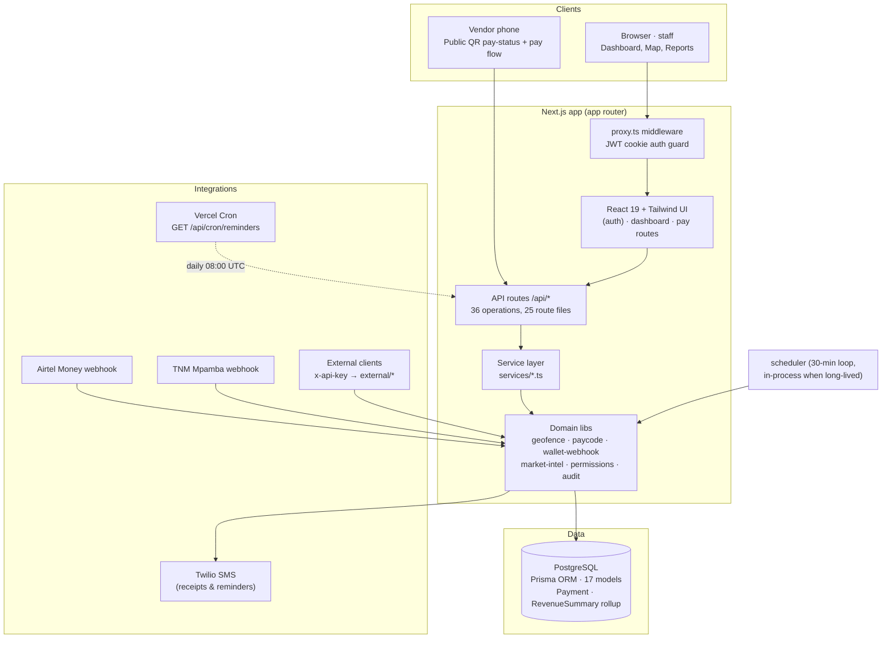
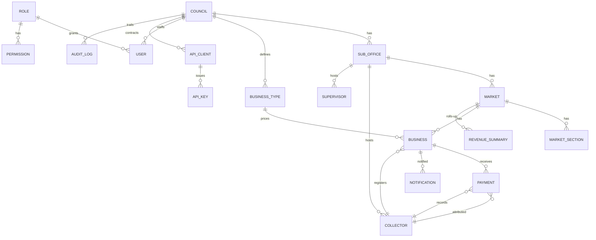

# Msika — Digital Market Fee Management & Revenue Monitoring System

**Blantyre City Council · Limbe Market (case study)**
A digital platform for accurate daily market fee collection, live stall mapping,
real-time revenue monitoring, SMS receipts/reminders and vendor payment verification —
replacing paper-based ticket collection that leaked revenue.

[](https://nextjs.org)
[](https://www.typescriptlang.org)
[](https://www.prisma.io)
[](https://react.dev)
[](https://tailwindcss.com)
[](#validation)

---

## Modules

| Module | What it does |
|---|---|
| **Dashboard** | Live KPIs: total/active vendors, paid vs unpaid today, cash collected, compliance %, revenue trend |
| **Vendors** | Register vendors, search by name/phone/stall, vendor profile + payment history |
| **Live Map** | Geo-fenced Leaflet map of Limbe Market; green dot = paid today, red = unpaid |
| **Payments** | Record cash (collector) or initiate mobile-money payments; verify by vendor number |
| **Reports / Pulse** | Daily/weekly revenue breakdowns by channel (Cash, AirtelMoney, TNMMpamba), section, fee type |
| **Markets** | Markets & sections with vendor counts and Market Growth insight |
| **Collectors / Supervisors** | Add and manage field staff; collector cash stats |
| **Reminders** | SMS payment reminders to today's unpaid vendors (Twilio) with 6h cooldown |
| **API Management** | Register provider integrations, mint API keys (secret shown once), enable/disable |
| **Audit Logs** | Every registration, payment, login, key action recorded — admin view |
| **Settings** | Dark/light theme, profile, sign-out |

Signed-in users only: all modules sit behind cookie-session auth and role-based
access control (Administrator / Supervisor / Collector).

## Quick start

```bash
cd msika-app

# 1. Configure env (Postgres must be reachable)
cp .env.example .env
#    DATABASE_URL   = postgresql://…
#    JWT_SECRET     = openssl rand -base64 32

# 2. Install + create schema + seed demo data (council, sub-office, market,
#    sections, business types with fees, staff, vendors, sample payments)
npm install
npx prisma migrate dev
npx prisma db seed        # prints the seeded test credentials

# 3. Run
npm run dev               # http://localhost:3000

# 4. Show everything works (end-to-end API will run the suite)
BASE=http://localhost:3000 sh scripts/smoke.sh
# → SUMMARY: PASS 56 / WARN 0 / FAIL 0 — ALL FEATURES OPERATIONAL
```

Seeded examples: vendors `V-01001`, `V-01002`, … record cash payments as a
collector or scan a vendor QR code to see the flow end-to-end.

Default test accounts are **test-data only** (`admin`, `j.phiri`, `a.banda`,
`m.banda` — passwords printed by the seed script). Rotate/replace before any real deployment.

---

## A. Scope of the system

### A.1 — Objectives

1. Digitize daily market fee collection at Limbe Market (paper-free tickets).
2. Give collectors a map-first view of which stalls are unpaid today.
3. Accept both **cash** (collector-recorded) and **mobile money**
   (Airtel Money / TNM Mpamba webhook-driven) for the same fee structure.
4. Monitor revenue live — dashboard + daily reports per channel and section.
5. Remind unpaid vendors automatically (SMS).
6. Keep every action auditable for council accountability.

### A.2 — Actors & User Cases

| Actor | Auth | Scope |
|---|---|---|
| Administrator | username + password (bcrypt, JWT cookie) | everything in all markets |
| Supervisor | username + password | all data in **their sub-office** |
| Collector | username + password | vendors + cash payments |
| Vendor | no account — QR-code walk-in or field assistance | own stall |
| Externals (Airtel, TNM) | API key (`x-api-key`) | sandbox/production webhooks |

Core use cases:

- **UC-1 Record a cash payment (Collector).**
  Collector logs in → Map/Trace-Unpaid shows today's red stalls → taps stall →
  confirms amount (default = vendor's fee) → copy printed citation → payment is
  stored `status=COMPLETED`, collector attributed; vendor turns green; SMS receipt queued.

- **UC-2 Enrol a vendor (Collector/Supervisor).**
  Open Vendor module → Fill in stall details, fee amount, section → submit →
  system allocates unique `vendor_number` (e.g. `V-01002`), geo-fences the
  coordinates (or auto-places them inside the boundary), SMS queues a
  welcome/receipt.

- **UC-3 Vendor pays via mobile money / QR (Vendor walk-up).**
  Vendor scans their stall's QR code (rendered per vendor) → public
  pay-status endpoint → initiates Airtel/TNM wallet payment via
  `POST /api/payments` → payment stays `PENDING` → provider posts a webhook
  (`/api/webhook/airtel`, `/api/webhook/mpamba`) → flips to `COMPLETED` or
  `FAILED`, receipt SMS fires, map flips green.

- **UC-4 External provider API (Airtel/TNM).**
  Register client → admin API Management issues an API key (secret hashed with
  SHA-256, plaintext shown once) → client fetches
  `/api/external/vendors?vendor_number=V-01001` or pushes transactions to
  `/api/external/payments`; per-key rate limit enforced (default 1000 req/day).

- **UC-5 Verify a payment on the field.**
  Any staff can hit `/api/payments/verify?vendor_number=V-01001` — one call
  returns vendor profile, today's fee, paid/unpaid and last 10 payments.

- **UC-6 Revenue reporting (Supervisor/Admin).**
  `/api/reports/daily?date=YYYY-MM-DD` → totals by channel, fee type,
  market section + revenue summaries (from `RevenueSummary` roll-up table).

- **UC-7 Reminders.**
  `/api/reminders` lists today's unpaid; `POST /api/reminders` SMSes them;
  cron (Vercel Cron 08:00 UTC daily, plus an in-process 30-min loop where the
  server persists) auto-runs reminders with a 6-hour per-vendor cooldown.

- **UC-8 Oversight.** Admin reviews `AuditLog` entries; toggles/deactivates
  supervisors/collectors; manages API keys and their activity.

### A.3 — Constraints

| Type | Constraint |
|---|---|
| Business | Fee variants fixed by invoice types (Market Vendor 300, Kupikulisa 2000, Restaurant/Butchery 500 — seeded `BusinessType` fees); vendors pay once per calendar day (server-enforced idempotency) |
| Regulatory | Council boundaries & fee schedule fixed per sub-office; strict council ownership on all data (`council_id`) |
| Technical | Single-region start (Malawi); mobile-first usage on field collectors' Android devices; 2G-level connectivity tolerated (fast pages, tiny payloads) |
| Non-functional targets | p95 API response < ~300 ms for < 10k vendors; 99.9 % availability; cash amounts recorded in integer MWK; **zero money-path data loss** (transactions wrapped in Prisma `$transaction` + `RevenueSummary` rollups) |
| Environment | Secrets via env only — `DATABASE_URL`, `JWT_SECRET`, `CRON_SECRET`, optional `TWILIO_*`; no `.env` committed |

---

## B. High-level architecture



Request flow (happy path, cash):

```
Collector (cookie) → Header/Search → useVendor.ts (hooks) → /api/payments (POST)
  → SessionAuth check → permissions cash-allowed → PaymentService.createPayment
  → Transaction { Payment INSERT COMPLETED · RevenueSummary upsert }
  → audit_log INSERT (action=PAYMENT) → Notification (receipt SMS queue)
  → Response JSON → hooks invalidate → Map/StatsCard refetches (green dot)
```

### B.1 — Scaling the abstract design

| Dimension | Approach |
|---|---|
| **Vertical** | Postgres on managed vCPU/RAM tier; Prisma pg-adapter connection size tuned; Next.js is stateless so bigger instance helps web only |
| **Horizontal** | Web is 12-factor/stateless (JWT cookie only, no server-side sessions): scale N Next.js containers behind a load balancer; cron dedupe via `MIN_RUN_INTERVAL_MS` DB-free in-process + Vercel Cron producing the single scheduled trigger |
| **Caching** | Client: `useDashboard`/`useVendor` hooks hold stale-while-revalidate data; DB short-TTL via Postgres buffer cache; Vercel CDN caches `/_next/static` immutably; no app-level cache needed for writes (single Postgres) |
| **Load balancing** | Vercel/any CDN LB by default; self-host: Nginx round-robin + health-check `/api/auth/me` |
| **DB replication** | Postgres streaming replica for reads (reports, market-intel heavy aggregates); Prisma can be pointed to a `DATABASE_REPLICA_URL` for read paths |
| **Partitioning** | `Payment` & `AuditLog` are the write-heavy tables — time-range partition by month via native PG partitioning when so large; `RevenueSummary` already pre-aggregates to bounded rows per market/day |
| **Map-Reduce equivalent** | Market-intel aggregation (`buildMarketIntel`) = one Prisma pass over windowed payments; at scale, move to a nightly batch job writing into `RevenueSummary`/materialized views, Map-reduce over months of payments |
| **Platform layer** | Vercel (compute + CDN + Cron), Neon/Supabase (Postgres + PITR), Twilio (SMS), Airtel/TNM (payment-provider integration) |
| **Estimates (Limbe scale)** | ~1–10k vendors × ≤ 2 writes/vendor/day → ≤ ~20k payment writes/day peak (trivial for Postgres); map feed = 1 vendor read per request, cached per user session; SMS volume ≈ 1 receipt + ≤ 4 reminders/day/vendor max cooldown |
| **Availability & reliability** | Stateless app tier → rolling deploys; Postgres managed backups + PITR; webhook side idempotent on `transaction_ref` (retries safe); reminder failure is silent-safe (logged) and retried next cycle; audit rows written best-effort but wrapped in try/catch so money path never blocks |
| **Bottlenecks (known)** | (1) Postgres write amplification on map/dashboard heavy days — mitigated by `RevenueSummary` pre-agg; (2) Twilio SMS latency — fire-and-forget via notification queue row; (3) market-intel recompute per request — memoized in-process and ready for a materialized view; (4) wallet webhook trust — currently unsigned for Airtel/TNM; wrap in HMAC signature verification when going live with real providers |

### B.2 — Web-app design considerations checklist

| Concern | Status / implementation |
|---|---|
| Security (CORS/JWT/XSS) | Same-origin API routes (no CORS surface), httpOnly JWT cookies, bcrypt hashes, SHA-256 API-key hash, per-key rate limit, RBAC on every route, geo-fence validated |
| CDN | Vercel edge CDN for static assets out of the box |
| Full-text search | Prisma `contains` searches by vendor/stall/owner/phone; ready to swap to PG `tsvector`/pg_trgm index when corpus grows |
| Offline / PWA | Not yet — planned service-worker cache of last map + vendor list |
| Web Workers | Not needed at current scale (all aggregation is server side) |
| SSR / client | Server components for shell/data, client components only where interactivity is required (`components/dashboard/*`) |
| Async/lazy assets | Map bundle is dynamically imported (`mapLib`), recharts lazy on dashboard |
| Minimize requests | React server components cut request count; single `useDashboard` bulk endpoint instead of many micro calls |
| Developer productivity | TypeScript everywhere, shared `types/*`, ESLint 9, seed script, smoke suite (56 checks), self-documenting API-test doc (`docs/api-test-suite.md`) |
| Accessibility | Semantic HTML + labeled controls, keyboard-navigable drawers/modals, AA-contrast palette |
| i18n | String-driven UI (English today); copy centralized for easy Chichewa swap |
| Responsive | Mobile-first: bottom tab bar + slide-up drawer on phones, sidebar on ≥ lg |
| Browser compat | Evergreen browsers; Leaflet/SVG fallbacks for older Android WebView |

---

## C. Component design

### C.1 — Service layer (Object-oriented design)

Thin, typed service modules in `services/` own business rules and are the only
callers of Prisma (route handlers stay transport-shaped):

```
services/
  AuthService.ts       login/verify/logout, bcrypt+JWT cookie, role resolve
  DashboardService.ts  stats aggregation, revenue by channel & section
  VendorService.ts     register (fee validation, geo-fence asset, vendor_number allocation)
                       search by name / phone / stall / section
  PaymentService.ts    recordCashPayment / initiateWalletPayment / verifyByVendorNumber
  CollectorService.ts  add/deactivate collectors, performance stats (cash totals)
  ReportService.ts     dailyPulse & summaries (charts from RevenueSummary)
```

Domain libraries under `lib/`:

| lib | Responsibility |
|---|---|
| `geofence.ts` | Limbe Market polygon + `pointInPolygon` (ray-casting), snap-to-boundary for vendor GPS drift, distance calc |
| `paycode.ts` | Stable per-vendor payment reference generator & verifier (HMAC-able, signed with `JWT_SECRET`), used for the QR walk-in payment page |
| `wallet-webhook.ts` | Normalizes Airtel/TNM transactions: charset/status mapping, idempotency on ref, credited/failed transitions for pending records |
| `permissions.ts` | Role scope decision object per role; `businessScopeFilter`/`paymentScopeFilter` return the Prisma record filter for staff (so wallet-initiators only see their own flows) |
| `audit.ts` | `logAudit()` — IP + user-agent + actor + resource + JSON detail |
| `sms.ts` / `notify.ts` | Twilio send or log-fallback; every vendor notification is stored in `Notification` (status Sent/Logged) |
| `market-intel.ts` / `mri.ts` | **Market watch scoring engine** — computes a 0–100 “Msika Reliability Index” (MRI) per vendor using EWMA payment compliance with a **10-day half-life**, streak momentum saturation at 14 days, consistency penalty, and empirical-Bayes shrinkage toward the sub-office prior (k=10). Tiers: Excellent ≥85, Reliable ≥70, Watch ≥50, At Risk ≥30, Chronic |
| `rate-limit.ts` | Fixed-window per API key |
| `auto-reminders.ts` | Self-driving reminder loop (in-process scheduler + cron endpoint), 6h cooldown per vendor |
| `tenants.ts` | Council/sub-office context resolution |

### C.2 — API reference (the endpoints that exist)

All under `app/api/**`. Cookie-auth endpoints expect the `token` httpOnly cookie (8 h). **Scopes are enforced server-side (`lib/permissions.ts`)**: administrators see everything, supervisors their sub-office only, and collectors only what they themselves recorded / were assigned.

| Method & path | Auth | Purpose |
|---|---|---|
| `POST /api/auth/login` | — | username+password → sets `token` cookie (8 h) |
| `POST /api/auth/logout` | — | clears cookie |
| `GET /api/auth/me` | cookie | current user profile |
| `GET /api/vendors` · `?search=` | cookie | list vendors (+ today's paid status per vendor) |
| `POST /api/vendors` | cookie | register vendor (`business_name, owner_name, phone_number, market_id, business_type_id` required; geo-fenced location) |
| `GET /api/vendors/{vendor_number\|business_id}` | cookie | vendor profile, including last-30 payments (scoped) |
| `GET /api/vendors/meta` | cookie | business types + fees, markets+sections (registration form data) |
| `GET /api/payments` · `?status=&search=&limit=` | cookie | transaction list with vendor + collector info (scoped) |
| `POST /api/payments` | cookie | record payment: cash collector→`COMPLETED` instantly; mobile-money initiation→`PENDING` until webhook |
| `GET /api/payments/verify?vendor_number=V-01001` | cookie | on-the-spot payment verification (status, today's fee, history) |
| `GET /api/public/pay-status?vendor_number=…` | public | minimal stall info + day fee + allow QR-code display |
| `POST /api/pay/paycode` | paycode | public QR walk-in payment (vendor paycode-authenticated) |
| `GET /api/map` · `?filter=paid\|unpaid=` | cookie | vendor positions + statuses + today's stats for the live map |
| `GET /api/dashboard` | cookie | KPI totals, revenue trend, section split |
| `GET /api/reports/daily?date=YYYY-MM-DD` | cookie | report per day: totals, transaction count, distinct paying vendors, and breakdowns by channel, fee type and section; omit date = today |
| `GET /api/audit-logs` | admin | audit trail (filterable) |
| `GET/POST/PATCH /api/api-clients` | admin | register provider clients, mint API keys (secret shown once), enable/disable |
| `GET/POST /api/collectors` | admin | list/post collectors |
| `GET/POST/DELETE /api/supervisors` | admin | list/post/deactivate supervisors |
| `GET/POST /api/markets` | staff | list markets for staff, admin creates |
| `GET /api/market-intel` · `GET /api/pulse` | cookie | MRI vendor scoring & market pulse |
| `GET/POST /api/reminders` | cookie | unpaid list / trigger SMS reminders |
| `GET/POST /api/cron/reminders` | cron-bearer | scheduled reminder runner (`x-cron-secret`) |
| `GET /api/external/vendors · /api/external/payments` | x-api-key | provider integration APIs (rate-limited) |
| `POST /api/webhook/airtel` · `/api/webhook/mpamba` | public* | wallet provider callbacks: accept completed ops (credit list, business_id match, or payer wallet number); unsigned today — **add HMAC verification before live traffic** |

*Detailed request/response shapes, validation & error codes (400/401/403/404/409) per endpoint: [`docs/api-test-suite.md`](docs/api-test-suite.md).

### C.3 — Database schema (PostgreSQL + Prisma, 17 models)



Core tables (all `snake_case`, Prisma 7 with `@prisma/adapter-pg`):

- **Tenancy** — `Council(1)`, `SubOffice(n)`, `Market`, `MarketSection`
- **People** — `User(admin)`, `Collector`, `Supervisor`, `Role`, `Permission`
  (bcrypt-hashed passwords, unique usernames, `is_active` soft deletes)
- **Commerce** — `BusinessType (name, fee_amount numeric(10,2))`,
  `Business (vendor_number unique V-NNNNN, stall_number, gps coords, wallet_number, preferred_wallet, status PENDING/ACTIVE/SUSPENDED/INACTIVE, registered_by_collector_id → Collector)`
- **Money** — `Payment (business_id, collector_id?, amount, fee_type, payment_channel AirtelMoney|TNMMpamba|USSD|Bank|Cash, transaction_ref unique, status Pending|Completed|Failed|Reversed|Refunded, paid_at, sms_sent, receipt_generated)`,
  `RevenueSummary (@@unique(market_id, summary_date))` — daily pre-aggregate: totals, transaction and success counts
- **External access** — `ApiClient`, `ApiKey (key_hash sha256, permissions, rate_limit, expires_at)`
- **Governance** — `AuditLog (actor_type User|ApiClient|System, action, resource, resource_id, details, ip_address, user_agent)`,
  `Notification (recipient, type SMS/Email/Push, channel Payment/Registration/Reminder, status Pending/Sent/Failed/Logged, content, sent_at)`

Data integrity rules (enforced in code + DB): one completed payment per vendor
per day (unique look-up + 409 on re-entry), fee amount must match the vendor's
`BusinessType.fee_amount`, transactions wrapped in `prisma.$transaction`, every
completed payment incrementally rolls into `RevenueSummary` (idempotent upsert).

### C.4 — Validation

- `scripts/smoke.sh` — **end-to-end API suite, 56 checks (currently all passing)**:
  login as admin/collector, RBAC 403 negatives, vendor registration duplicates,
  cash payment + idempotency, wallet initiation + webhook fulfillment (both
  provider cards), external API-key access + rate limit, map payloads, market
  intelligence, reminders with cooldown, daily report shape, audit-log entries,
  QR paycode and public pay-status.
- `docs/api-test-suite.md` — beginner-friendly cURL walkthrough per endpoint
  (TEST 1 → TEST 9) including expected status codes and database-verification
  queries for the same flows (independent of any single test script).
- Type safety: `tsc` strict; typed API payloads; `next build` gate.

## D. Deployment (Vercel)

1. Import the repository in Vercel, **Root Directory**: `msika-app`.
2. Framework preset: Next.js; build command stays `npm run build` (Prisma
   generate + `migrate deploy` run via the `vercel-build` hook).
3. Environment variables per environment: `DATABASE_URL`, `JWT_SECRET`,
   `CRON_SECRET` (all three required before first deploy), plus
   `TWILIO_ACCOUNT_SID/TOKEN/PHONE_NUMBER` to enable real SMS, and any
   `MSIKA_FORCE_*` provider keys only when going live with real wallets.
4. Provision PostgreSQL (Neon/Supabase/RDS) and run `npx prisma migrate deploy` once.
5. Vercel Cron calls `/api/cron/reminders` daily 08:00 UTC with the
   `CRON_SECRET` as Bearer token.

Runbook: `npx prisma migrate reset` + `npm run db:seed` (dev only);
production uses `migrate deploy` — never reset a live DB.

---

*Maintained by the Msika engineering workspace. Authoritative API contract:
route handlers in `app/api/**` + `docs/api-test-suite.md`.*
